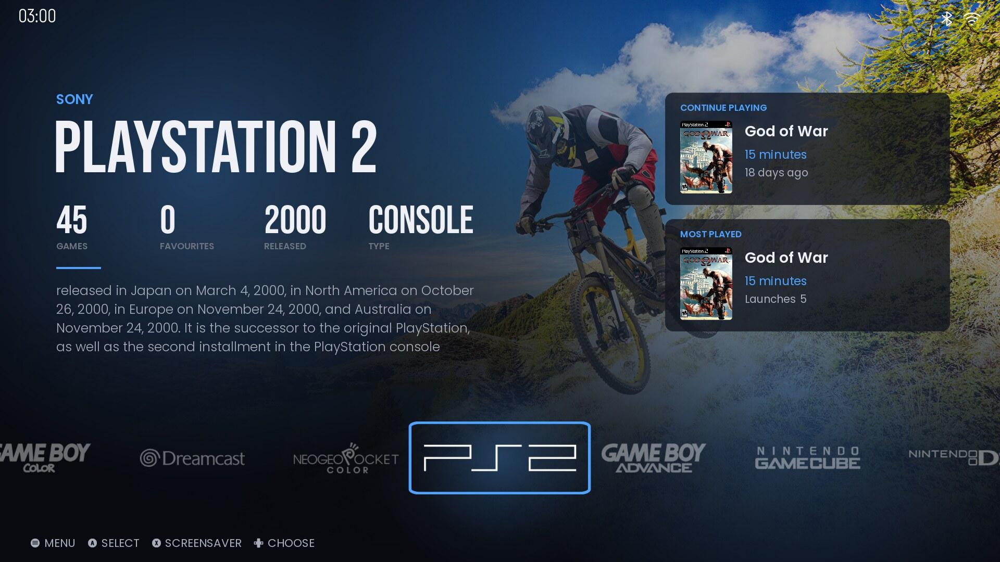
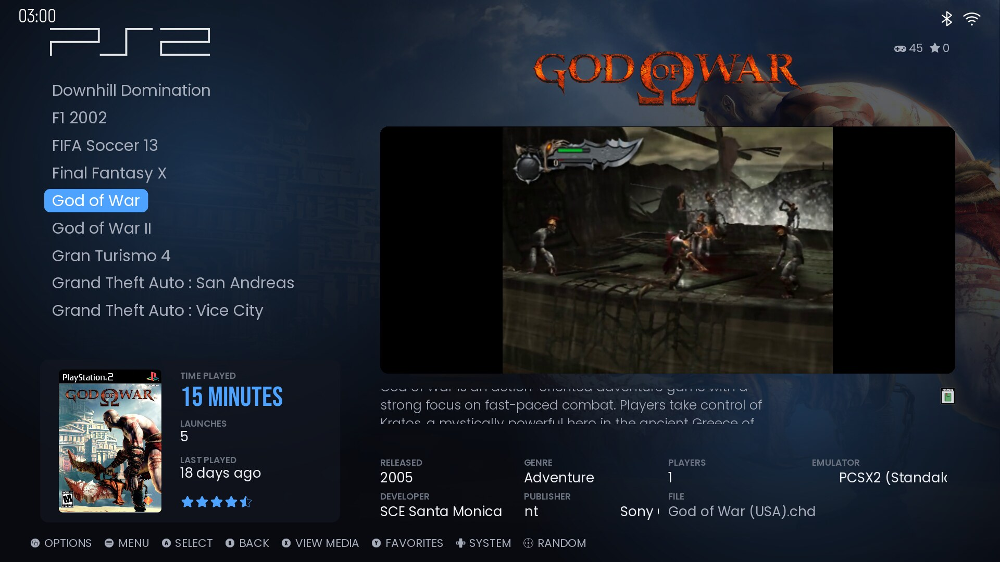
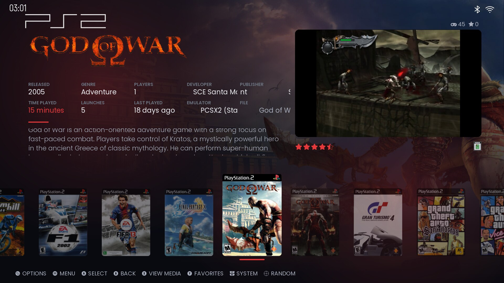
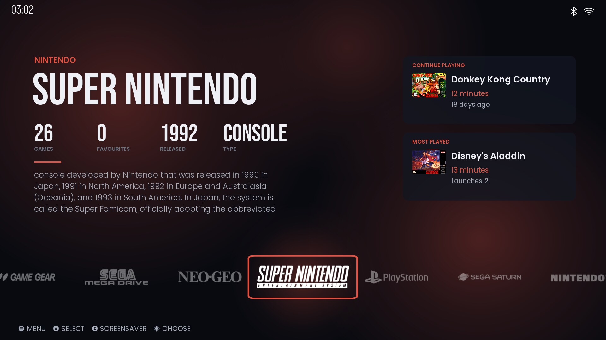
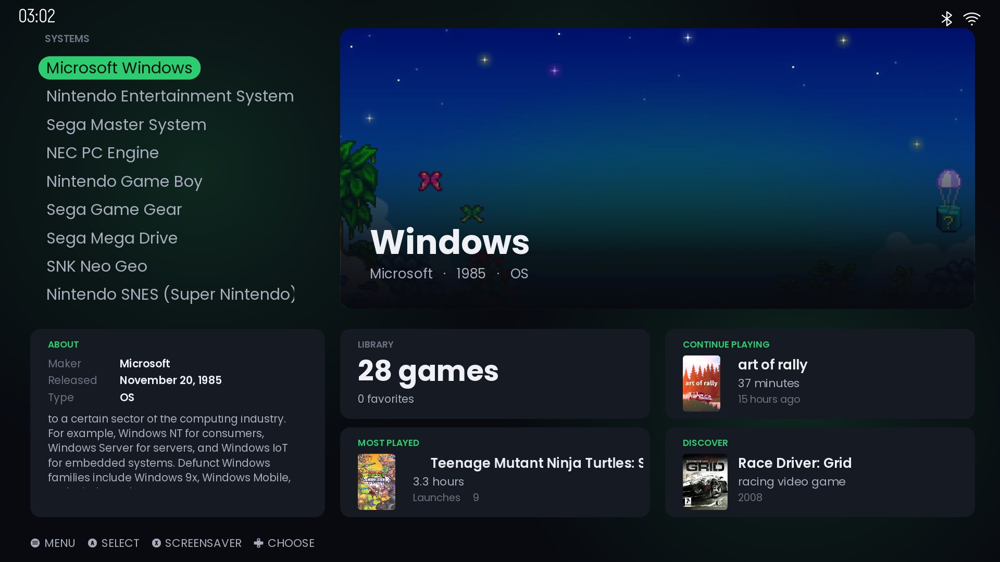
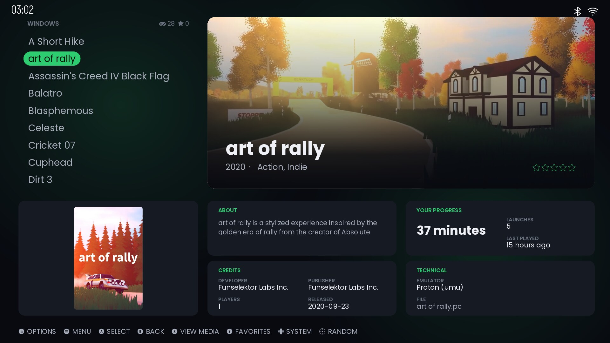
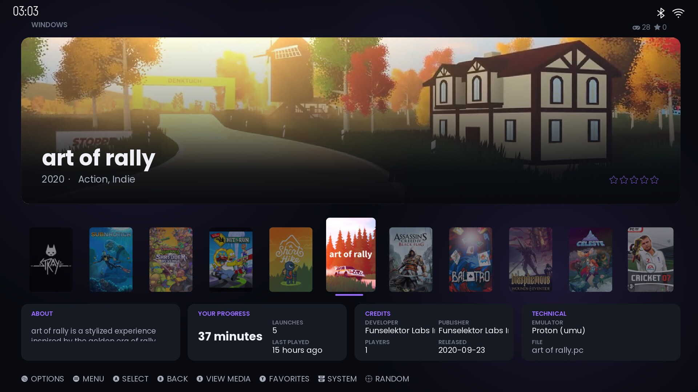

# Afterglow for ES-DE

A dark, stats-rich theme for [ES-DE](https://es-de.org) with two looks, **Cinematic** and **Clean**, ten accent colours and a soft accent glow over your game art.

## Features

- **Two looks, each with a list and a carousel game view** (4 variants)
  - **Cinematic** – full-screen fan art, big type, a logo row on the home screen
  - **Clean** – a calm system list with a hero card and tidy info tiles
- **10 accent colours** – Ice blue, Crimson, Ember orange, Gold, Emerald, Teal, Violet, Rose, Monochrome and **System colour** (follows each console's own colour)
- **Lots of stats**
  - Home screen: game count, favourites, release year, maker, type, *Continue playing*, *Most played* and *Discover* (a random game)
  - Game view: time played, launches, last played, release date, genre, players, developer, publisher, rating, emulator and file name
- Videos with fan art fallback, scrolling text for long names and values
- 16:9 and 16:10 support, medium and large font sizes, fade or instant transitions
- Lightweight: no full-screen animations, so it stays smooth on low-power hardware

## Screenshots

| | |
|---|---|
|  |  |
| *Cinematic – list* | *Cinematic – carousel* |
|  |  |
| *System colour accent* | *Clean – home* |
|  |  |
| *Clean – list* | *Clean – carousel* |

Screenshots use the author's own scraped media; game art is not included with the theme.

## Installation

1. Download this repository (green **Code** button → **Download ZIP**, or `git clone https://github.com/arshitsrivastava/afterglow-es-de.git`).
2. Place the `afterglow-es-de` folder in your ES-DE themes directory:
   - Linux / macOS: `~/ES-DE/themes/`
   - Windows: `ES-DE\themes\` next to your ES-DE installation (or your custom ES-DE home)
   - Android: `ES-DE/themes/` in the ES-DE folder you chose at setup
3. Restart ES-DE, then pick **Afterglow** in *Main Menu → UI Settings → Theme*.
4. In the same menu choose the **Theme variant** (look), **Theme color scheme** (accent) and **Theme font size**.

### Recommended media

Afterglow uses *fan art*, *screenshots*, *covers*, *marquees (logos)* and *videos*. Scrape these with ES-DE's built-in scraper for the best result. Games without media fall back gracefully.

## Support

If you enjoy Afterglow, you can support its development:

Bug reports and suggestions are welcome in [Issues](https://github.com/arshitsrivastava/afterglow-es-de/issues).

## Credits and license

The theme is released under the [MIT License](LICENSE). Bundled system metadata, logos and fonts keep their own licenses. See [CREDITS.md](CREDITS.md).
